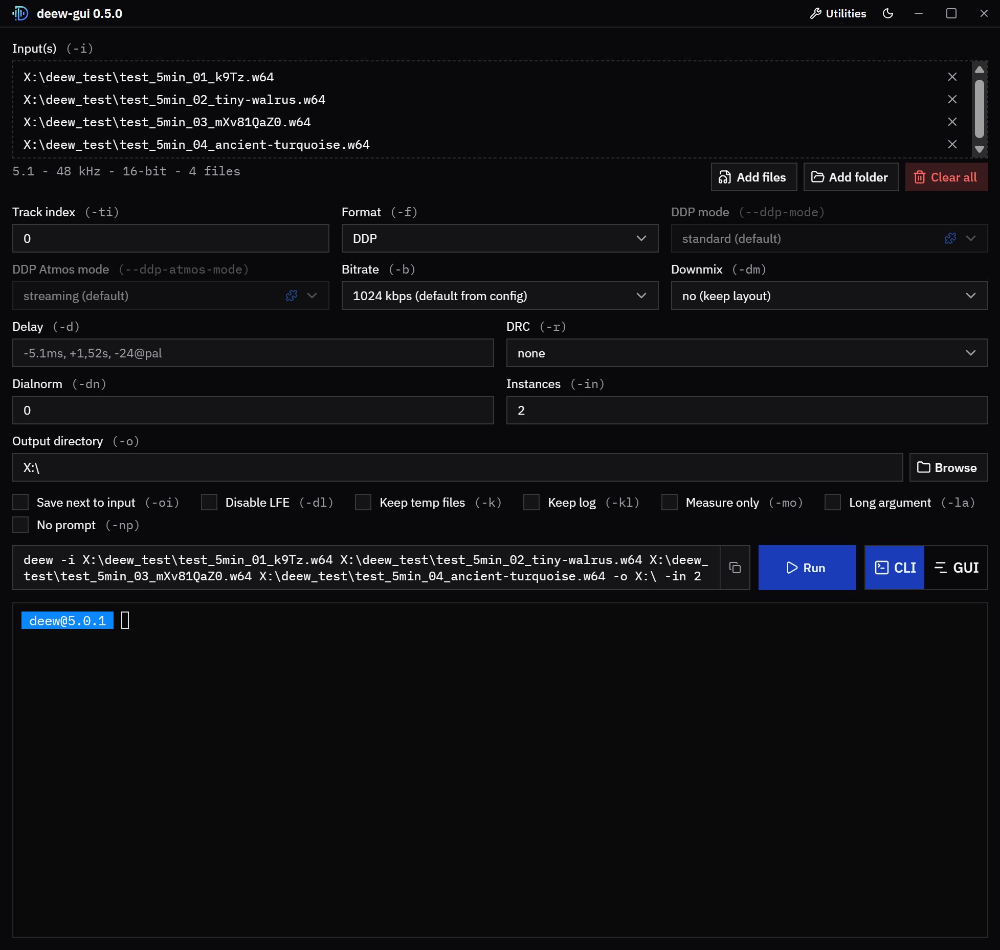

[](https://github.com/pcrlnd/deew/actions/workflows/build.yaml)
[](https://github.com/pcrlnd/deew/releases)
[](https://crates.io/crates/deew)
[](https://github.com/pcrlnd/deew/blob/main/LICENSE)
\
[](https://t.me/deew_supp)
\
[](https://github.com/pcrlnd/deew/commits/main)
[](https://github.com/pcrlnd/deew/issues)
[](https://github.com/pcrlnd/deew/issues?q=is%3Aissue+is%3Aclosed)
\
[](https://github.com/pcrlnd/deew)
[](https://customer.dolby.com/content-creation-and-delivery/dolby-encoding-engine-v670)
<hr>
<p align="center"><br>Dolby Encoding Engine Wrapper</p>

<p align="center"><a href="https://github.com/pcrlnd/deew/blob/main/README.md">English readme</a>
 • <a href="https://github.com/pcrlnd/deew/blob/main/README_hu.md">Magyar leírás</a></p>

## DDP encoding has never been so easy!



# Description
- drives the command line tools of Dolby Encoding Engine 6.7 and creates the intermediate files in the background, giving you a proper tool
- encodes DD, DDP, DDP Atmos, TrueHD, TrueHD Atmos, AC4, AC4 Atmos and AAC (always 2.0, mono inputs are rejected)
- re-encodes TrueHD Atmos to DDP Atmos / TrueHD Atmos / AC4 Atmos from the Atmos master (raw `.thd` or a container like mkv/mka/m2ts, use `-ti` to select the track; decoded with truehdd, DDP Atmos and TrueHD Atmos use dee_shim to stop DEE smoothing the object positions a second time)
- runs multiple encodes in parallel for batch encoding (see config)
- works on Windows, Linux and macOS
- automatic sample rate conversion using ffmpeg's soxr resampler in case of an unsupported sample rate
  - for DD/DDP/AC4 unsupported rates will be converted to 48 kHz
  - for TrueHD unsupported rates will be converted to 48 kHz if source sample rate is lower than 72 kHz, otherwise will be converted to 96 kHz
- automatic channel swapping for 7.1 sources (DEE swaps Ls Rs with Lrs Rrs for some reason)
- automatically compensates for the delay of the encoders: 256 samples for DD/DDP, 2048 for AC4 and 1600 for AAC (TrueHD has none)
- works even with video inputs
- `-mo` and `-dn` (loudness measurement) don't support 7.1 sources
- versatile delay option that supports ms, s and also frame@fps formats, parsing delay from filenames also supported

The [deew tool chain](https://deew.app/tool-chain) page shows how deew connects ffprobe, ffmpeg, truehdd, dee_shim and the DEE tools, with the exact options it passes to each one for every format.

# Requirements
- ffmpeg
- ffprobe
- [Dolby Encoding Engine 6.7](https://customer.dolby.com/content-creation-and-delivery/dolby-encoding-engine-v670)
- [truehdd](https://github.com/truehdd/truehdd) (only for the Atmos formats: `ddp-atmos`, `thd-atmos`, `ac4-atmos`)
- [dee_shim](https://github.com/truehdd/dee-shim) (only for `ddp-atmos`, `thd-atmos`, TrueHD with DRC `none`, the standard profile of 7.1 DDP and 7.0 DDP)
  - `ddp-atmos` and `thd-atmos` use it so DEE doesn't smooth the object positions of the TrueHD decode a second time, TrueHD with DRC `none` (the default) uses it because the TrueHD encoder has no `none` DRC preset

# DDP profiles
`--ddp-mode` selects the profile of 7.1 DDP and `--ddp-atmos-mode` the profile of `ddp-atmos`, the defaults are in the config's `[default_modes]` section:
- 7.1 DDP (`--ddp-mode`):
  - standard (default, needs dee_shim): E-AC-3 independent and dependent substreams, 384-1792 kbps, `.ec3` output
  - bluray (native, no dee_shim needed): AC-3 core and E-AC-3 dependent substream, 768-1664 kbps, `.eb3` output
- DDP Atmos (`--ddp-atmos-mode`):
  - streaming (default): 5.1 with Atmos in one E-AC-3 substream, 384-1024 kbps, `.ec3` output
  - standard: 7.1 with Atmos, E-AC-3 independent and dependent substreams, 768-2048 kbps, `.ec3` output
  - bluray: 7.1 with Atmos, AC-3 core and E-AC-3 dependent substream, 1152-1664 kbps, `.eb3` output
- in `-h` and `-lb` the values that use dee_shim are blue (`blue: uses dee_shim`)

# Where deew looks for the programs
deew looks for the programs in this order, there is nothing to set in the config:
1. next to the deew executable (the DEE tools in the `dee` folder next to it)
2. your PATH

`deew -v` shows what it found and where.

`deew -gt` / `deew --get-tools` downloads everything except DEE next to deew: ffmpeg, ffprobe, truehdd and dee_shim (ffmpeg is the latest stable GPL build from [BtbN](https://github.com/BtbN/FFmpeg-Builds) on Windows/Linux and from [martin-riedl.de](https://ffmpeg.martin-riedl.de/) on macOS). DEE can't be downloaded, install it by hand (see below).

```
deew(.exe)
ffmpeg(.exe), ffprobe(.exe), truehdd(.exe), dee_shim(.exe)
dee/  (dee_ddp_encoder, dee_dthd_encoder, ... license.lic)
```

# Dolby Encoding Engine installation
- install [VisualCppRedist AIO](https://github.com/abbodi1406/vcredist/releases) on Windows
- install [DEE 6.7](https://customer.dolby.com/content-creation-and-delivery/dolby-encoding-engine-v670), use the version that matches your OS (Windows, Linux or macOS)
  - DEE 5.2.1 and older versions are not supported anymore
- put the folder of the DEE tools (`dee_ddp_encoder`, `dee_ac4_encoder`, ...) next to deew and name it `dee`, or put the tools in your PATH
- the Linux version of DEE doesn't include a TrueHD encoder (`dee_dthd_encoder`): [dthd-mac2linux](https://github.com/truehdd/dthd-mac2linux) can build a Linux `dee_dthd_encoder` from the macOS one, put it into the DEE folder
- on Apple silicon the macOS tools need Rosetta 2

# deew (CLI) installation
### with standalone build (Windows 10-11/Linux/macOS):
- grab the latest build (`deew` / `deew.exe` / `deew-macos`) from: [https://github.com/pcrlnd/deew/releases](https://github.com/pcrlnd/deew/releases)
- on Linux/macOS make it executable: `chmod +x deew` (`chmod +x deew-macos` on macOS)
- run with: `deew` (`deew.exe` on Windows, `deew-macos` on macOS)\
*(run the binary from terminal, doubleclicking it won't work)*
- on the first run it will create a config file (the tools go next to deew or in your PATH, see above)
- run `deew -gt` to download everything except DEE (ffmpeg, ffprobe, truehdd, dee_shim) next to deew
- updating: grab the latest build from: [https://github.com/pcrlnd/deew/releases](https://github.com/pcrlnd/deew/releases)

### build from source (Windows/Linux/macOS):
- install Rust if you don't have it already: [https://rustup.rs](https://rustup.rs)
- run: `cargo install deew`
- run with: `deew`
- on the first run it will create a config file
- updating: run the same command again: `cargo install deew`
- after updating from deew 3.x or older generate a new config with `deew -gc` (the config format changed in 5.0.0)

### Usage
- `deew -h`

```
USAGE: deew [-h] [-v] [-i [INPUT ...]] [-ti INDEX] [-o DIRECTORY] [-oi]
            [-f FORMAT] [--ddp-mode MODE] [--ddp-atmos-mode MODE] [-b BITRATE]
            [-dm CHANNELS] [-dl] [-d DELAY] [-r DRC] [-dn DIALNORM] [-in NUMBER]
            [-k] [-kl] [-mo] [-lb] [-la] [-np] [-pl] [-cl] [-c] [-gc] [-gt]

FLAGS:
  -h, --help                show this help message.
  -v, --version             show version and the versions of the tools.
  -i, --input [INPUT ...]   audio file(s) or folder(s)
  -ti, --track-index INDEX  default: 0
                            select audio track index of input(s)
  -o, --output DIRECTORY    default: output path of the config, else the current
                            directory
                            specifies output directory
  -oi, --output-to-input    save each output next to its input file
                            overrides -o and the output path of the config
  -f, --format FORMAT       options: dd / ddp / ddp-atmos / thd / thd-atmos /
                            ac4 / ac4-atmos / aac
                            default: ddp
                            ddp-atmos and thd-atmos use truehdd and dee_shim,
                            ac4-atmos uses truehdd
  --ddp-mode MODE           options: standard / bluray
                            default: run -c/--config
                            profile of 7.1 DDP, 5.1 and below are not affected
                            standard: E-AC-3 only, 384-1792 kbps
                            bluray: AC-3 core + E-AC-3, 768-1664 kbps
  --ddp-atmos-mode MODE     options: streaming / standard / bluray
                            default: run -c/--config
                            profile of ddp-atmos
                            streaming: 5.1 with Atmos, 384-1024 kbps
                            standard: 7.1 with Atmos, E-AC-3 only, 768-2048 kbps
                            bluray: 7.1 with Atmos, AC-3 core + E-AC-3,
                            1152-1664 kbps
  -b, --bitrate BITRATE     options: run -lb/--list-bitrates
                            default: run -c/--config
  -dm, --downmix CHANNELS   options: 1 / 2 / 6
                            specifies downmix, only works for DD/DDP/AC4/AAC and
                            TrueHD (2 / 6)
                            DD and AC4 will be automatically downmixed to 5.1 in
                            case of a 7.1 source
                            AAC output is always 2.0
  -dl, --disable-lfe        remove the LFE channel of 5.1 and 7.1 inputs
                            DD and DDP get a real 5.0 or 7.0, the others keep a
                            silent LFE
                            5.0 and 7.0 inputs are supported, they have no LFE
  -d, --delay DELAY         examples: -5.1ms, +1,52s, -24@pal, +10@24000/1001
                            default: 0ms or parsed from filename
                            specifies delay as ms, s or frame@FPS
                            FPS can be a number, division or ntsc / pal
                            you have to specify negative values as -d=-0ms
  -r, --drc DRC             options: none / film_light / film_standard /
                            music_light / music_standard / speech
                            default: none (music_light for AC4)
                            specifies drc profile
                            none uses dee_shim for TrueHD, not available for AC4
  -dn, --dialnorm DIALNORM  options: between -31 and 0 (in case of 0 DEE's
                            measurement will be used)
                            default: 0
                            applied dialnorm value, doesn't work for AAC and
                            AC4 Atmos
  -in, --instances NUMBER   examples: 1, 4, 50%
                            default: 50%
                            specifies how many encodes can run at the same time
                            50% means 4 on a cpu with 8 threads
                            one DEE can use 2 threads so 50% can utilize all
                            threads
                            (this option overrides the config's number)
  -k, --keeptemp            keep temp files
  -kl, --keep-log           keep TrueHD's log and write a .deew-log.html report
                            for each output
  -mo, --measure-only       only measures the loudness with DEE, no encoding
  -lb, --list-bitrates      list bitrates that DEE can do for each format
  -la, --long-argument      print ffmpeg, truehdd and DEE arguments for each
                            input
  -np, --no-prompt          skip confirmation questions, print them as notes and
                            continue
  -pl, --print-logos        show all logo variants you can set in the config
  -cl, --changelog          show changelog
  -c, --config              show config and config location
  -gc, --generate-config    generate a new config
  -gt, --get-tools          download ffmpeg, ffprobe, truehdd and dee_shim next
                            to deew

blue: uses dee_shim
```

# GUI
- download `deew-gui` / `deew-gui.exe` / `deew-gui-macos` from [https://github.com/pcrlnd/deew/releases](https://github.com/pcrlnd/deew/releases) and put it in the same folder as the CLI binary (it looks for `deew` next to itself, `deew.exe` on Windows)
- on Linux/macOS make the binaries executable: `chmod +x deew deew-gui` (`chmod +x deew-macos deew-gui-macos` on macOS)
- Linux needs the WebKitGTK runtime: `libwebkit2gtk-4.1-0` (Debian/Ubuntu), `webkit2gtk4.1` (Fedora), `webkit2gtk-4.1` (Arch)
- Windows 10/11 already include the needed `WebView2` runtime
- the GUI has its own version number, independent from the CLI
- build from source: `cd gui && npm install && npm run tauri build -- --no-bundle` (the binary will be in `gui/target/release/`), for development use `npm run tauri dev`
- more details (development, web mode, security notes): [GUI readme](https://github.com/pcrlnd/deew/blob/main/gui/README.md)

# Web UI
- `deew-web` is the GUI in your browser, can be handy for a headless server (no WebKit needed)
- download `deew-web` / `deew-web.exe` / `deew-web-macos` from [https://github.com/pcrlnd/deew/releases](https://github.com/pcrlnd/deew/releases) and put it next to the CLI binary, 
- on Linux/macOS run `chmod +x deew-web` (`chmod +x deew-web-macos` on macOS)
- run it and open [http://127.0.0.1:8765](http://127.0.0.1:8765), use `--host 0.0.0.0` to make it reachable from other machines
- login: run the `deew-web --hash-password` command and paste the hash into your `config.toml` file
- build from source: `cd gui && npm install && npm run build && cargo build -p deew-web --release` (the binary will be in `gui/target/release/`)

# Examples
`deew -i *thd`\
TrueHD -> DDP encoding

`deew -b 768 -i *flac`\
DDP encoding at 768kbps

`deew -f ddp-atmos -i *thd`\
TrueHD Atmos -> DDP Atmos encoding from the Atmos master (uses truehdd and dee_shim)

`deew -f thd-atmos -i *thd`\
TrueHD Atmos -> TrueHD Atmos re-encode (16 elements, uses truehdd and dee_shim)

`deew -f ac4-atmos -b 448 -i *thd`\
TrueHD Atmos -> AC4 Atmos encoding at 448kbps

`deew -f dd -i *dts -k`\
`deew -f ddp -i *dts`\
encode multiple formats/bitrates while creating the temp file only once

# Discussion and Support
[https://t.me/deew_supp](https://t.me/deew_supp)

# Donate
If you like deew, you can support the people behind it on Ko-fi or with Monero.

pcroland:
-  [Ko-fi](https://ko-fi.com/pcrlnd)
- Monero:
  ```
  42pcroLMNqQbs87sSuNNTk8E8XHD88NhnSAx3exA3s1mHWAAyKH1oBw7dScYVRx3VJhUZT96QZNeo9Uw2qL72kwoHxVBXmL
  ```

rainbaby (developer of truehdd and dee_shim):
```
47BgNcwYCWhSHB3WMd7CPLX3Yb4Kz8TCsGJaUmX7KqG895UKvixks6yje3GSa489XR97FLQMcUaSacAHbMbF2xWz7dvyX9U
```
