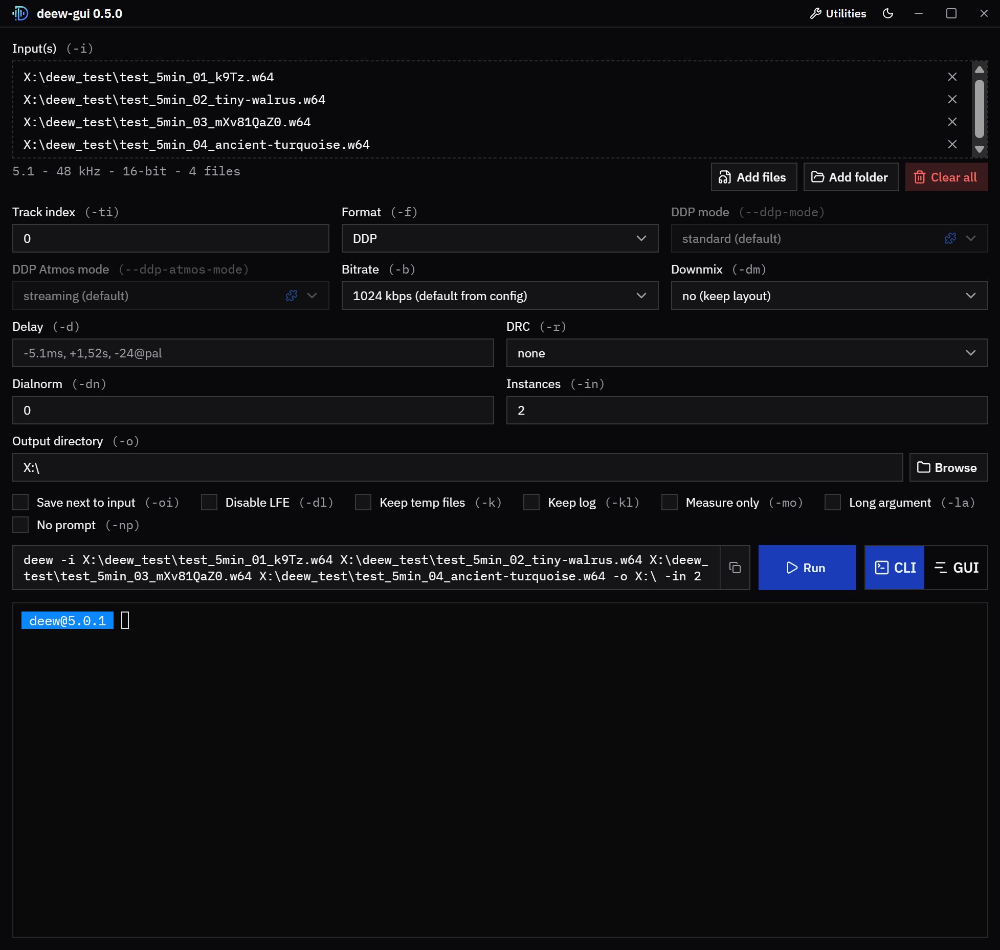

[](https://github.com/pcrlnd/deew/actions/workflows/build.yaml)
[](https://github.com/pcrlnd/deew/releases)
[](https://crates.io/crates/deew)
[](https://github.com/pcrlnd/deew/blob/main/LICENSE)
\
[](https://t.me/deew_supp)
\
[](https://github.com/pcrlnd/deew/commits/main)
[](https://github.com/pcrlnd/deew/issues)
[](https://github.com/pcrlnd/deew/issues?q=is%3Aissue+is%3Aclosed)
\
[](https://github.com/pcrlnd/deew)
[](https://customer.dolby.com/content-creation-and-delivery/dolby-encoding-engine-v670)
<hr>
<p align="center"><br>Dolby Encoding Engine Wrapper</p>

<p align="center"><a href="https://github.com/pcrlnd/deew/blob/main/README.md">English readme</a>
 • <a href="https://github.com/pcrlnd/deew/blob/main/README_hu.md">Magyar leírás</a></p>

## DDP encode-olás még sosem volt ilyen egyszerű!



# Leírás
- a Dolby Encoding Engine 6.7 parancssori eszközeit vezérli, és a háttérben létrehozza az intermediate fájlokat, rendes felületet adva
- DD, DDP, DDP Atmos, AC4, AC4 Atmos, AAC (mindig 2.0, mono inputot elutasít) és TrueHD encode-olás
- a TrueHD Atmos-t az Atmos masterből kódolja újra DDP Atmos / TrueHD Atmos / AC4 Atmos formátumba (nyers `.thd` vagy konténer, pl. mkv/mka/m2ts, a sávot a `-ti`-vel lehet kiválasztani; truehdd-vel dekódolja, a DDP Atmos és a TrueHD Atmos a dee_shim-et használja, hogy a DEE ne simítsa az objektumpozíciókat másodszor is)
- több kódolást párhuzamosan futtat batch encodingnál (lásd config)
- működik Windowson, Linuxon és macOS-en
- automatikus mintavételezésiráta-konvertálás ffmpeg soxr resamplerét használva nem támogatott mintavételezési ráta esetén
  - DD/DDP/AC4 esetén a mintavételezési rátát 48 kHz-re konvertálja
  - TrueHD esetén a mintavételezési rátát 48 kHz-re konvertálja, ha a forrásé kisebb mint 72 kHz, fölötte 96 kHz-re
- automatikus csatornafelcserélés 7.1-es forrásoknál (DEE valamiért megcseréli az Ls, Rs csatornákat az Lrs, Rrs-sel)
- automatikusan kompenzálja az encoderek késleltetését: DD/DDP esetén 256, AC4 esetén 2048, AAC esetén 1600 minta (a TrueHD-nél nincs)
- akár videó inputokkal is működik
- az `-mo` és a `-dn` (hangosságmérés) nem támogat 7.1-es forrást
- sokoldalú delay opció, ami támogat ms, s and és frame@fps formát is, delay parse-olása fájlnévből szintén támogatott

A [deew tool chain](https://deew.app/tool-chain) oldal megmutatja, hogyan köti össze a deew az ffprobe-ot, az ffmpeg-et, a truehdd-t, a dee_shim-et és a DEE eszközeit, és formátumonként pontosan milyen opciókat ad át mindegyiknek.

# Követelmények
- ffmpeg
- ffprobe
- [Dolby Encoding Engine 6.7](https://customer.dolby.com/content-creation-and-delivery/dolby-encoding-engine-v670)
- [truehdd](https://github.com/truehdd/truehdd) (csak az Atmos formátumokhoz: `ddp-atmos`, `thd-atmos`, `ac4-atmos`)
- [dee_shim](https://github.com/truehdd/dee-shim) (csak a `ddp-atmos`-hoz, a `thd-atmos`-hoz, a TrueHD `none` DRC-hez, a 7.1 DDP standard profiljához és a 7.0 DDP-hez)
  - told a deew mellé vagy a PATH-ba
  - a `ddp-atmos` és a `thd-atmos` használja, hogy a DEE ne simítsa másodszor is a TrueHD dekódolás objektumpozícióit, a TrueHD `none` DRC-vel (ez az alapértelmezett) azért, mert a TrueHD encodernek nincs `none` DRC presetje

# DDP profilok
A `--ddp-mode` a 7.1 DDP, a `--ddp-atmos-mode` a `ddp-atmos` profilját választja ki, az alapértelmezések a config `[default_modes]` részében vannak:
- 7.1 DDP (`--ddp-mode`):
  - standard (alapértelmezett, dee_shim kell hozzá): E-AC-3 independent és dependent substream, 384-1792 kbps, `.ec3` kimenet
  - bluray (natív, dee_shim nem kell): AC-3 mag és E-AC-3 dependent substream, 768-1664 kbps, `.eb3` kimenet
- DDP Atmos (`--ddp-atmos-mode`):
  - streaming (alapértelmezett): 5.1 Atmosszal egy E-AC-3 substreamben, 384-1024 kbps, `.ec3` kimenet
  - standard: 7.1 Atmosszal, E-AC-3 independent és dependent substream, 768-2048 kbps, `.ec3` kimenet
  - bluray: 7.1 Atmosszal, AC-3 mag és E-AC-3 dependent substream, 1152-1664 kbps, `.eb3` kimenet
- a `-h` és az `-lb` kékkel jelöli azokat az értékeket, amelyek a dee_shim-et használják (`blue: uses dee_shim`)

# Hol keresi deew a programokat
A deew ebben a sorrendben keresi a programokat, a configban nincs mit beállítani:
1. a deew futtatható fájlja mellett (a DEE eszközöket az mellette lévő `dee` mappában)
2. a PATH-ban

A `deew -v` megmutatja, mit talált meg és hol.

A `deew -gt` / `deew --get-tools` a DEE kivételével mindent letölt a deew mellé: az ffmpeg-et, az ffprobe-ot, a truehdd-t és a dee_shim-et (az ffmpeg a legújabb stabil GPL build, Windowson/Linuxon a [BtbN](https://github.com/BtbN/FFmpeg-Builds)-től, macOS-en a [martin-riedl.de](https://ffmpeg.martin-riedl.de/)-ről). A DEE nem tölthető le, azt kézzel kell telepíteni (lásd lent).

```
deew(.exe)
ffmpeg(.exe), ffprobe(.exe), truehdd(.exe), dee_shim(.exe)
dee/  (dee_ddp_encoder, dee_dthd_encoder, ... license.lic)
```

# Dolby Encoding Engine telepítése
- Windowson telepítsd fel a [VisualCppRedist AIO](https://github.com/abbodi1406/vcredist/releases)-t
- telepítsd fel a [DEE 6.7](https://customer.dolby.com/content-creation-and-delivery/dolby-encoding-engine-v670)-et, az operációs rendszerednek megfelelő verziót (Windows, Linux vagy macOS)
  - a DEE 5.2.1 és a régebbi verziók már nem támogatottak
- told a DEE eszközeit (`dee_ddp_encoder`, `dee_ac4_encoder`, ...) tartalmazó mappát a deew mellé `dee` néven, vagy told az eszközöket a PATH-ba
- a DEE Linux-verziója nem tartalmaz TrueHD encodert (`dee_dthd_encoder`): a [dthd-mac2linux](https://github.com/truehdd/dthd-mac2linux) a macOS-es változatból tud Linuxos `dee_dthd_encoder`-t buildelni, ezt told a DEE mappájába
- Apple silicon gépen a macOS-es eszközökhöz Rosetta 2 kell

# deew (CLI) telepítése
### standalone buildet használva (Windows 10-11/Linux/macOS):
- tölsd le a legfrissebb buildet (`deew` / `deew.exe` / `deew-macos`) innen: [https://github.com/pcrlnd/deew/releases](https://github.com/pcrlnd/deew/releases)
- Linuxon/macOS-en tedd futtathatóvá: `chmod +x deew` (macOS-en `chmod +x deew-macos`)
- futtasd: `deew` (Windowson `deew.exe`, macOS-en `deew-macos`)\
*(terminálból futtasd, duplaklikk nem fog működni)*
- az első futtatáskor készíteni fog egy config fájlt (az eszközöket told a deew mellé vagy a PATH-ba, lásd fent)
- a `deew -gt` a DEE kivételével mindent letölt a deew mellé (ffmpeg, ffprobe, truehdd, dee_shim)
- frissítés: tölsd le a legfrissebb buildet innen: [https://github.com/pcrlnd/deew/releases](https://github.com/pcrlnd/deew/releases)

### forrásból buildelve (Windows/Linux/macOS):
- telepítsd a Rustot, ha még nincs fent: [https://rustup.rs](https://rustup.rs)
- futtasd a következő parancsot: `cargo install deew`
- futtasd: `deew`
- az első futtatáskor készíteni fog egy config fájlt
- frissítés: futtasd újra ugyanezt a parancsot: `cargo install deew`
- a deew 3.x vagy régebbi verziójáról frissítve generálj új configot a `deew -gc` paranccsal (a config formátuma megváltozott az 5.0.0-ban)

### Használat
- `deew -h`

```
USAGE: deew [-h] [-v] [-i [INPUT ...]] [-ti INDEX] [-o DIRECTORY] [-oi]
            [-f FORMAT] [--ddp-mode MODE] [--ddp-atmos-mode MODE] [-b BITRATE]
            [-dm CHANNELS] [-dl] [-d DELAY] [-r DRC] [-dn DIALNORM] [-in NUMBER]
            [-k] [-kl] [-mo] [-lb] [-la] [-np] [-pl] [-cl] [-c] [-gc] [-gt]

FLAGS:
  -h, --help                show this help message.
  -v, --version             show version and the versions of the tools.
  -i, --input [INPUT ...]   audio file(s) or folder(s)
  -ti, --track-index INDEX  default: 0
                            select audio track index of input(s)
  -o, --output DIRECTORY    default: output path of the config, else the current
                            directory
                            specifies output directory
  -oi, --output-to-input    save each output next to its input file
                            overrides -o and the output path of the config
  -f, --format FORMAT       options: dd / ddp / ddp-atmos / thd / thd-atmos /
                            ac4 / ac4-atmos / aac
                            default: ddp
                            ddp-atmos and thd-atmos use truehdd and dee_shim,
                            ac4-atmos uses truehdd
  --ddp-mode MODE           options: standard / bluray
                            default: run -c/--config
                            profile of 7.1 DDP, 5.1 and below are not affected
                            standard: E-AC-3 only, 384-1792 kbps
                            bluray: AC-3 core + E-AC-3, 768-1664 kbps
  --ddp-atmos-mode MODE     options: streaming / standard / bluray
                            default: run -c/--config
                            profile of ddp-atmos
                            streaming: 5.1 with Atmos, 384-1024 kbps
                            standard: 7.1 with Atmos, E-AC-3 only, 768-2048 kbps
                            bluray: 7.1 with Atmos, AC-3 core + E-AC-3,
                            1152-1664 kbps
  -b, --bitrate BITRATE     options: run -lb/--list-bitrates
                            default: run -c/--config
  -dm, --downmix CHANNELS   options: 1 / 2 / 6
                            specifies downmix, only works for DD/DDP/AC4/AAC and
                            TrueHD (2 / 6)
                            DD and AC4 will be automatically downmixed to 5.1 in
                            case of a 7.1 source
                            AAC output is always 2.0
  -dl, --disable-lfe        remove the LFE channel of 5.1 and 7.1 inputs
                            DD and DDP get a real 5.0 or 7.0, the others keep a
                            silent LFE
                            5.0 and 7.0 inputs are supported, they have no LFE
  -d, --delay DELAY         examples: -5.1ms, +1,52s, -24@pal, +10@24000/1001
                            default: 0ms or parsed from filename
                            specifies delay as ms, s or frame@FPS
                            FPS can be a number, division or ntsc / pal
                            you have to specify negative values as -d=-0ms
  -r, --drc DRC             options: none / film_light / film_standard /
                            music_light / music_standard / speech
                            default: none (music_light for AC4)
                            specifies drc profile
                            none uses dee_shim for TrueHD, not available for AC4
  -dn, --dialnorm DIALNORM  options: between -31 and 0 (in case of 0 DEE's
                            measurement will be used)
                            default: 0
                            applied dialnorm value, only works for DD/DDP/AC4
  -in, --instances NUMBER   examples: 1, 4, 50%
                            default: 50%
                            specifies how many encodes can run at the same time
                            50% means 4 on a cpu with 8 threads
                            one DEE can use 2 threads so 50% can utilize all
                            threads
                            (this option overrides the config's number)
  -k, --keeptemp            keep temp files
  -kl, --keep-log           keep TrueHD's log and write a .deew-log.html report
                            for each output
  -mo, --measure-only       only measures the loudness with DEE, no encoding
  -lb, --list-bitrates      list bitrates that DEE can do for each format
  -la, --long-argument      print ffmpeg, truehdd and DEE arguments for each
                            input
  -np, --no-prompt          skip confirmation questions, print them as notes and
                            continue
  -pl, --print-logos        show all logo variants you can set in the config
  -cl, --changelog          show changelog
  -c, --config              show config and config location
  -gc, --generate-config    generate a new config
  -gt, --get-tools          download ffmpeg, ffprobe, truehdd and dee_shim next
                            to deew

blue: uses dee_shim
```

# GUI
- tölsd le a `deew-gui` / `deew-gui.exe` / `deew-gui-macos` fájlt innen: [https://github.com/pcrlnd/deew/releases](https://github.com/pcrlnd/deew/releases), és told a CLI binárisod mellé ugyanabba a mappába (a mellette lévő `deew` fájlt keresi, Windowson `deew.exe`-t)
- Linuxon/macOS-en tedd futtathatóvá a binárisokat: `chmod +x deew deew-gui` (macOS-en `chmod +x deew-macos deew-gui-macos`)
- Linuxon szükség van a WebKitGTK runtime-ra: `libwebkit2gtk-4.1-0` (Debian/Ubuntu), `webkit2gtk4.1` (Fedora), `webkit2gtk-4.1` (Arch)
- Windows 10/11 már tartalmazza a szükséges `WebView2` runtime-ot
- a GUI saját verziószámot használ, a CLI-tól függetlenül
- forrásból buildelve: `cd gui && npm install && npm run tauri build -- --no-bundle` (a binárist a `gui/target/release/` mappában találod), fejlesztéshez használd: `npm run tauri dev`
- részletesebb leírás (fejlesztés, webes mód, biztonsági megjegyzések): [GUI leírás](https://github.com/pcrlnd/deew/blob/main/gui/README_hu.md)

# Web UI
- a `deew-web` a GUI a böngésződben, hasznos lehet egy headless szerverhez (nem kell hozzá WebKit)
- tölsd le a `deew-web` / `deew-web.exe` / `deew-web-macos` fájlt innen: [https://github.com/pcrlnd/deew/releases](https://github.com/pcrlnd/deew/releases), és tedd a CLI binary mellé
- Linuxon/macOS-en futtasd: `chmod +x deew-web` (macOS-en `chmod +x deew-web-macos`)
- indítsd el, és nyisd meg: [http://127.0.0.1:8765](http://127.0.0.1:8765), használd `--host 0.0.0.0`-t, hogy más gépekről is elérhető legyen
- bejelentkezés: futtasd a `deew-web --hash-password` parancsot, és másold a hash-t a `config.toml` fájlodba
- forrásból buildelve: `cd gui && npm install && npm run build && cargo build -p deew-web --release` (a binárist a `gui/target/release/` mappában találod)

# Példák
`deew -i *thd`\
TrueHD -> DDP encode-olás

`deew -b 768 -i *flac`\
DDP encode-olás 768kbps-kel

`deew -f ddp-atmos -i *thd`\
TrueHD Atmos -> DDP Atmos encode-olás az Atmos masterből (truehdd-t és dee_shim-et használja)

`deew -f thd-atmos -i *thd`\
TrueHD Atmos -> TrueHD Atmos újrakódolás (16 elem, truehdd-t és dee_shim-et használja)

`deew -f ac4-atmos -b 448 -i *thd`\
TrueHD Atmos -> AC4 Atmos encode-olás 448kbps-kel

`deew -f dd -i *dts -k`\
`deew -f ddp -i *dts`\
több formátum/bitráta kódolása egy ideiglenes fájl készítésével

# Beszélgetés és support
[https://t.me/deew_supp](https://t.me/deew_supp)

# Támogatás
Ha tetszik a deew, Ko-fi-on vagy Moneróval támogathatod a mögötte álló embereket.

pcroland:
-  [Ko-fi](https://ko-fi.com/pcrlnd)
- Monero:
  ```
  42pcroLMNqQbs87sSuNNTk8E8XHD88NhnSAx3exA3s1mHWAAyKH1oBw7dScYVRx3VJhUZT96QZNeo9Uw2qL72kwoHxVBXmL
  ```

rainbaby (a truehdd és a dee_shim fejlesztője):
```
47BgNcwYCWhSHB3WMd7CPLX3Yb4Kz8TCsGJaUmX7KqG895UKvixks6yje3GSa489XR97FLQMcUaSacAHbMbF2xWz7dvyX9U
```
